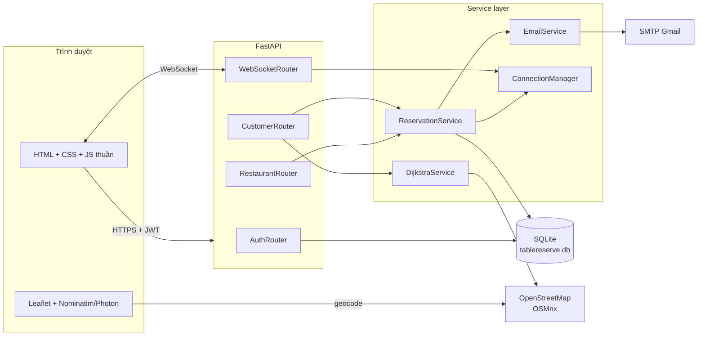

# Kết quả dự án — TableReserve

| | |
|---|---|
| **Dự án** | TableReserve — Hệ thống đặt bàn nhà hàng |
| **Phiên bản** | 1.0 |
| **Cập nhật** | 13/11/2026 |
| **Trạng thái** | Hoàn thành: backend, frontend, dữ liệu mẫu, tài liệu |
| **Môi trường kiểm thử** | Windows · Python 3.11 · SQLite · trình duyệt Chrome/Edge |

> Tài liệu liên quan: [README](../README.md) · [Phạm vi hệ thống](./system_scope.md) · [Use case](./use_case_diagram.md) · [Quy ước code](./code_conventions.md) · [Báo cáo tiến độ](./progress_report.md)

---

## 1. Mục tiêu và phạm vi

Xây dựng ứng dụng web đặt bàn nhà hàng hoạt động tại Hà Nội, phục vụ hai vai trò:

- **Khách hàng**: tìm chi nhánh gần nhất, đặt bàn, theo dõi lịch sử, hủy đơn theo quy định.
- **Chủ nhà hàng**: quản lý hồ sơ nhà hàng — chi nhánh, nhận và xử lý đơn đặt bàn theo thời gian thực.

Kết quả được đánh giá trên: chức năng hoàn thiện, độ đúng của nghiệp vụ, khả năng chịu lỗi và chất lượng mã nguồn.

---

## 2. Tóm tắt kết quả

| Hạng mục | Kết quả |
|---|---|
| API endpoints | **23** (5 auth · 6 customer · 11 restaurant · 1 WebSocket) |
| Trang giao diện | **8** HTML (giới thiệu, đăng nhập, đăng ký, 3 trang khách hàng, 2 trang nhà hàng) |
| Module JavaScript | **13** tệp |
| Bảng cơ sở dữ liệu | **5** bảng + 2 enum |
| Mã nguồn backend | **3.114** dòng Python |
| Mã nguồn frontend | **4.833** dòng JS · **7.293** dòng CSS · **1.344** dòng HTML |
| Kiểm thử tự động | **12/12 test pass** (email service, 0,11 s) |
| Dữ liệu mẫu | 11 nhà hàng · 31 chi nhánh · 977 bàn · 14 tài khoản |

---

## 3. Kết quả theo phân hệ

### 3.1. Khách hàng

- [x] Đăng ký / đăng nhập bằng JWT; phân quyền theo `role`.
- [x] Cập nhật hồ sơ (tên, số điện thoại, địa chỉ); xóa tài khoản.
- [x] Chọn vị trí bằng **GPS** hoặc **nhập địa chỉ**.
- [x] Geocode địa chỉ phía client: Nominatim → Photon, có chuẩn hóa tiếng Việt và truy vấn giảm dần độ chi tiết; dự phòng so khớp mờ với danh sách chi nhánh.
- [x] Hiển thị bản đồ Leaflet, marker chi nhánh, popup thông tin, vị trí người dùng.
- [x] Gợi ý **Top 5 chi nhánh gần nhất** theo khoảng cách đường bộ (Dijkstra) hoặc đường chim bay (Haversine).
- [x] Đặt bàn: chọn chi nhánh, ngày giờ, số khách, món đặt trước, ghi chú.
- [x] Vé xác nhận hiển thị mã đơn (`#TR-000012`), trạng thái động, không tự đóng.
- [x] Lịch sử đặt bàn: lọc theo trạng thái, phân trang, sắp xếp mới nhất theo `created_at`.
- [x] Hủy đặt bàn khi còn ≥ 24 giờ (BR-01), bàn trống được hoàn lại.
- [x] Giao diện sáng/tối, responsive.

### 3.2. Chủ nhà hàng

- [x] Tạo / cập nhật hồ sơ nhà hàng.
- [x] Dashboard thống kê đơn theo trạng thái.
- [x] Quản lý chi nhánh: thêm, sửa, xóa; chọn tọa độ trên bản đồ hoặc geocode từ địa chỉ.
- [x] Tự động điều chỉnh `available_tables` khi thay đổi `total_tables`.
- [x] Nhận đơn mới **realtime** qua WebSocket (tự kết nối lại sau 5 s, ping 25 s).
- [x] Xác nhận đơn `PENDING`.
- [x] Từ chối đơn kèm lý do bắt buộc (BR-02), hoàn bàn và gửi email.
- [x] Lọc danh sách đơn theo chi nhánh và trạng thái.

### 3.3. Dịch vụ hệ thống

- [x] Gửi **4 loại email** HTML: đã nhận đơn, xác nhận, từ chối, hủy — chạy nền bằng `ThreadPoolExecutor`, có retry; chưa cấu hình SMTP thì in ra log (mock mode).
- [x] Định tuyến Dijkstra trên đồ thị OpenStreetMap (OSMnx/NetworkX), cache `.pkl` theo tọa độ, bán kính 10 km.
- [x] Fallback nhiều tầng: đồ thị có hướng → đồ thị vô hướng → Haversine; lỗi một chi nhánh không ảnh hưởng chi nhánh khác.
- [x] Chống bán quá số bàn: khóa `asyncio.Lock` theo từng chi nhánh + kiểm tra `0 ≤ available_tables ≤ total_tables`.
- [x] Email/WebSocket chạy background task, lỗi không rollback giao dịch đã commit.
- [x] Phân quyền: chỉ `RESTAURANT_OWNER` gọi được API nhà hàng (403 với khách).
- [x] CORS cho frontend gọi API; tài liệu Swagger tự sinh tại `/docs`.

---

## 4. Kiến trúc hệ thống



- **Backend**: FastAPI + SQLAlchemy 2, chia router → service → model; Pydantic schema cho vào/ra.
- **Frontend**: HTML/CSS/JS thuần, không framework; `api.js` là lớp gọi API duy nhất, `auth.js` quản lý phiên.
- **Realtime**: WebSocket phân nhóm theo `restaurant_id`.
- **Tính toán đường đi**: tách riêng `dijkstra_service` để dễ test và tái sử dụng.

---

## 5. Cơ sở dữ liệu

```
users ──1:1── customers                    users ──1:1── restaurants ──1:N── branches
   │                │                          │
   └────────────────┴────── N:1 ── reservations ──────┘
```

| Bảng | Vai trò | Ràng buộc chính |
|---|---|---|
| `users` | Tài khoản đăng nhập | `email` UNIQUE, `role` enum `CUSTOMER`/`RESTAURANT_OWNER`, mật khẩu bcrypt |
| `customers` | Hồ sơ khách | `user_id` UNIQUE → users (CASCADE) |
| `restaurants` | Hồ sơ nhà hàng | `owner_id` UNIQUE → users (CASCADE) |
| `branches` | Chi nhánh | `restaurant_id` → restaurants (CASCADE); `latitude/longitude` NUMERIC(10,6); `available_tables` |
| `reservations` | Đơn đặt bàn | `customer_id`, `branch_id` (CASCADE); `status` enum; `rejection_reason` |

Trạng thái đơn: `PENDING → CONFIRMED | REJECTED | CANCELLED`. Mọi thay đổi `available_tables` nằm trong `ReservationService`.

---

## 6. API đã hoàn thiện (23 endpoint)

| Nhóm | Số lượng | Endpoint tiêu biểu |
|---|---|---|
| `/api/auth` | 5 | `POST /register`, `POST /login`, `GET/PUT/DELETE /me` |
| `/api/customer` | 6 | `GET /branches`, `GET /branches/nearby`, `POST /reservations`, `GET /reservations`, `GET /reservations/{id}`, `PATCH /reservations/{id}/cancel` |
| `/api/restaurant` | 11 | hồ sơ nhà hàng, CRUD chi nhánh, danh sách đơn, `confirm`, `reject` |
| `/ws` | 1 | `WS /restaurant/{restaurant_id}?token=<JWT>` |

Chi tiết đầy đủ: [README — API chính](../README.md#api-chính) và Swagger `http://localhost:8000/docs`.

---

## 7. Quy tắc nghiệp vụ đã đảm bảo

| Mã | Quy tắc | Cách thực hiện |
|---|---|---|
| BR-01 | Chỉ hủy đơn `PENDING`/`CONFIRMED` khi còn ≥ 24 giờ | Kiểm tra trước và sau khi lấy khóa chi nhánh |
| BR-02 | Từ chối bắt buộc nhập lý do | Validate ≥ 5 ký tự ở schema, kiểm tra lại ở service |
| — | Giờ hẹn phải ở tương lai | Chuẩn hóa UTC và so sánh thời điểm hiện tại |
| — | Không đặt khi chi nhánh ngừng hoạt động / hết bàn | Kiểm tra `is_active`, `available_tables > 0` |
| — | Không bán quá số bàn | Khóa theo chi nhánh + kiểm tra tính nhất quán bộ đếm |
| — | Hoàn bàn khi hủy / từ chối | `available_tables += 1` trong cùng transaction |
| — | Dữ liệu con bị xóa theo cha | `ondelete="CASCADE"` + `cascade="all, delete-orphan"` |

---

## 8. Kiểm thử và chất lượng

```bash
pytest tests -q      # 12 passed in 0.11s
```

- **Tự động**: `tests/test_email_service.py` — mock SMTP, định dạng nội dung, retry/backoff.
- **Thủ công end-to-end**: đăng ký → đăng nhập → chọn địa chỉ → đặt bàn → nhận email/WebSocket → nhà hàng xác nhận/từ chối → hủy đơn.
- **Kiểm tra cú pháp** JS bằng `node --check`; CSS cân bằng ngoặc; geocode đã đối chiếu với địa chỉ thực (`298 Cầu Diễn, Hà Nội`).
- Đã xử lý các lỗi phát hiện trong quá trình kiểm thử: geocode địa chỉ tiếng Việt, lịch sử đơn sắp xếp sai, vé xác nhận tự đóng, fallback demo khi backend lỗi HTTP.

---

## 9. Dữ liệu mẫu hiện có

Sinh bởi `seed_hanoi.py` (10 tài khoản chủ nhà hàng, 30 chi nhánh quanh Hà Nội); cơ sở dữ liệu phát triển hiện tại:

| Bảng | Số bản ghi | Ghi chú |
|---|---|---|
| `users` | 14 | 11 chủ nhà hàng + 3 khách hàng |
| `restaurants` | 11 | Thêm 1 nhà hàng khi kiểm thử |
| `branches` | 31 | Tổng 977 bàn, còn trống 478 |
| `reservations` | 11 | 8 `PENDING`, 2 `CONFIRMED`, 1 `CANCELLED` |

Tài khoản mẫu: `owner1@hanoi.vn` … `owner10@hanoi.vn` / mật khẩu `123456`.

---

## 10. Hạn chế còn lại

1. **SQLite + khóa trong một tiến trình**: `asyncio.Lock` chỉ chống oversell trong một process; chạy nhiều worker cần PostgreSQL + row lock/optimistic locking.
2. **Chưa có migration**: bảng tạo bằng `Base.metadata.create_all()`; thay đổi schema cần Alembic.
3. **`COMPLETED` chưa dùng**: enum có nhưng chưa có luồng chuyển trạng thái sau khi khách dùng bữa.
4. **`table_number` chưa tự động gán**: đơn `PENDING` hiển thị "sẽ được sắp xếp khi bạn đến"; chưa có thuật toán xếp bàn cụ thể.
5. **Cấu hình cứng**: `API_BASE`/`WS_BASE` trỏ `localhost:8000`; cần biến môi trường khi deploy.
6. **Bảo mật production**: `SECRET_KEY` mặc định, CORS `allow_origins=["*"]`, chưa rate-limit.
7. **Độ phủ test**: mới có email service; chưa có test tự động cho đặt bàn, phân quyền, Dijkstra.
8. **Phụ thuộc dịch vụ ngoài**: geocode (Nominatim/Photon) và OSM có thể bị giới hạn tần suất.

---

## 11. Hướng phát triển

- Chuyển sang PostgreSQL, thêm Alembic, khóa cấp bản ghi để chạy đa worker.
- Bổ sung xếp bàn tự động và trạng thái `COMPLETED` (quét đơn quá giờ).
- Viết test cho `ReservationService` (hủy 24h, reject, race condition) và router (401/403/404/409).
- Đóng gói Docker Compose (API + DB + static host), cấu hình qua biến môi trường.
- Thêm thanh toán cọc, đánh giá nhà hàng, thông báo đẩy/nhắc lịch.
- Nâng cấp geocode sang backend có cache để giảm phụ thuộc trình duyệt.

---

## 12. Kết luận

Dự án đã hoàn thành đầy đủ luồng nghiệp vụ cốt lõi của một hệ thống đặt bàn hai phía: khách hàng tìm – đặt – hủy, chủ nhà hàng quản lý – duyệt – từ chối theo thời gian thực. Các điểm kỹ thuật quan trọng đều được xử lý: chống oversell bằng khóa theo chi nhánh, định tuyến đường bộ có fallback, thông báo email/WebSocket không chặn giao dịch, và bảo mật JWT theo vai trò.

Hạn chế còn lại chủ yếu liên quan đến môi trường triển khai (SQLite, cấu hình cứng) và độ phủ kiểm thử — đã được liệt kê kèm hướng khắc phục, phù hợp để tiếp tục phát triển ở giai đoạn tiếp theo.
